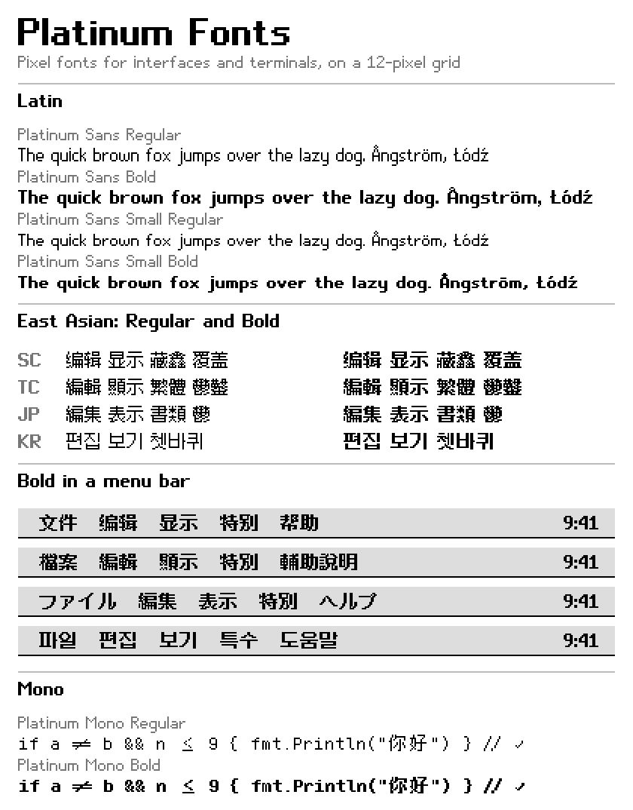
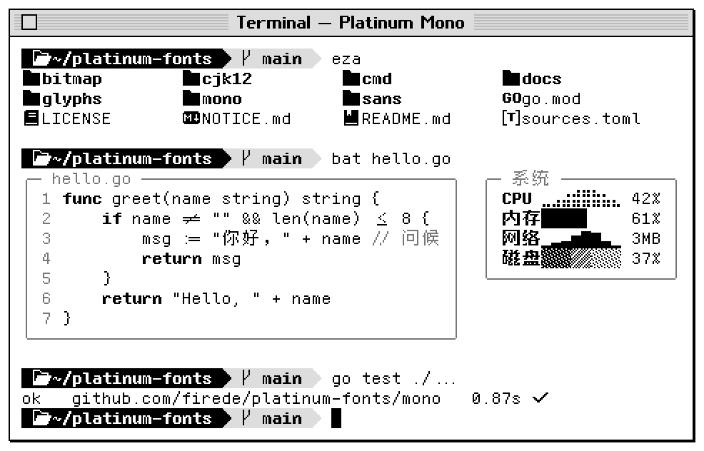

# Platinum Fonts

[English](README.md) | 简体中文

一套用于界面和终端的像素字体，绘制在 12 像素的网格上。西文与中文、日文、韩文
混排，在 12 像素及其整数倍下清晰锐利。

## 字族

- **Platinum Sans**：比例宽度的无衬线字体，用于界面文字。
- **Platinum Sans Small**：更小的无衬线字体，用于工具栏、状态栏等紧凑的布局。
- **Platinum Mono**：等宽字体，用于终端和代码。中文、日文、韩文占两格，与西文
  对齐。内置编程连字和 Nerd Fonts 图标。

每个字族都有 Regular 和 Bold 两种字重，并分为四个地区版本：**SC**（简体中文）、
**TC**（繁体中文）、**JP**（日文）和 **KR**（韩文）。各版本的西文相同，区别在于
汉字采用哪个地区的字形。选择你最常阅读的语言即可。

## 安装

从 [Releases](https://github.com/firede/platinum-fonts/releases) 下载 zip，每种格式
一个：

| 格式 | 用途 |
|---|---|
| `otf` | macOS、Windows 及大多数应用 |
| `ttf` | 不支持 OTF 的应用 |
| `woff2` | 网页 |
| `otb` | Linux 桌面（GTK、Pango） |
| `bdf`、`pcf` | X11 应用 |

- **macOS**：打开字体文件，点击“安装字体”。
- **Windows**：选中字体文件，右键选择“安装”。
- **Linux**：把字体文件复制到 `~/.local/share/fonts`，然后运行 `fc-cache -f`。

## 请在 12 像素下使用

每个字形都在 12 像素的网格上逐像素绘制，因此只有在 12 像素或其整数倍（24、36……）
下才清晰，其他字号会发虚。

| 环境 | 字号 |
|---|---|
| macOS（无论是否 Retina） | 12 或 24 |
| Windows，缩放 100% 或 200% | 9 pt 或 18 pt |
| 网页 | `font-size: 12px` 或 `24px` |

Windows 在 125%、150% 等其他缩放比例下，没有哪个字号能对齐整像素。

## 在终端中使用 Platinum Mono

把字体设为 `Platinum Mono SC`（或 TC、JP、KR），字号设为 12。

- **行高**已内置在字体中，终端的行高保持默认即可。每格宽 7 像素、高 14 像素。
- **图标**画两格宽、只占一格，与 Nerd Font（而非 Nerd Font Mono）相同。图标后
  要留一个空格；eza、Starship 等工具已经这样做了。
- **连字**会连接 `=>` `!=` `<=` `->` `::` `//` 等，共 31 个。它们通过 OpenType
  特性 `calt` 默认开启；BDF 和 PCF 不含连字。关闭方法：

  | 应用 | 设置 |
  |---|---|
  | Ghostty | `font-feature = -calt` |
  | Zed | `"buffer_font_features": { "calt": false }` |
  | VS Code | `"editor.fontLigatures": false` |
  | Kitty | `disable_ligatures always` |
  | WezTerm | `harfbuzz_features = { "calt=0" }` |

- **宽度不明确的字符**，如 `○` `★` 以及希腊字母、西里尔字母，占一格。请把终端的
  “模糊宽度”保持为窄（通常就是默认值）。

## 开发者

这些字体同时也是 Go 包，可以把文字绘制到图像中，见[开发](docs/development.zh.md)。
各字族如何制作、度量数据和来源，见[设计](docs/design.zh.md)。

## 许可

字体采用 [SIL Open Font License 1.1](OFL.txt)。Platinum Mono 还包含采用 MIT 许可证
的连字，以及采用各图标集许可证的图标；[NOTICE.md](NOTICE.md) 列出了所有来源及其
许可证。代码采用 [MIT 许可证](LICENSE)。
